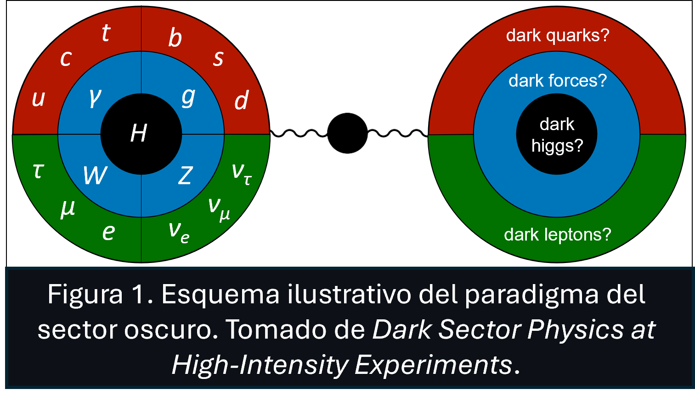

# Prácticas finales
* **Título**: *Análisis de datos del LHCb de un canal de señales para el estudio de materia oscura*

<!-- # Ejercicio Profecional Supervisado (EPS) -->
# Materia Oscura (DM)

| **Tipo de materia oscura** |  | **Descripción** |
| :----: | :----: | :---- |
| Materia oscura caliente | HDM | Materia (partículas) en movimiento relativista. Una característica de esta es que tiene dificultad para la formación de estructuras pequeñas. |
| Materia oscura tibia | WDM | La materia (partículas) poseen velocidades intermedias. Suprime parcialmente estructuras pequeñas. |
| Materia oscura fría | CDM | La materia (partículas) poseen velocidades no relativistas. A este tipo de materia oscura pertenecen los ``WIMPs``, ``axiones``, ``partículas del sector oscuro``, etc.

## Sector Oscuro
La consideración de un sector oscuro neutro bajo las fuerzas del Modelo Estándar (SM) ofrece una explicación para la existencia de la Materia Oscura (DM); esta permite la dirección de nueva física capaz de explorar cuestiones fundamentales como las masas de los neutrinos, el problema de la jerarquía y la asimetría materia-antimateria que se presenta en el Universo.

Los sectores oscuros se encuentran débilmente acoplados a la materia ordinaria, dado que usualmente poseen masas desde el rango de MeV hasta los GeV además de respetar las simetrias del Modelo Estándar; sin embargo, estos se encuentran levemente restringidos debido a los datos de colisionadores de alta energía y mediciones atómicas de precisión.

La motivación de un sector oscuro se debe a la existencia de la materia oscura, la cual se encuentra firmemente establecida debido a sus interacciones gravitatorias. Sin embargo, no se conoce mucho acerca de la naturaleza corpuscular de la Materia Oscura. Una posibilidad bien motivada es que la Materia Oscura pertenece a un sector oscuro de partículas de estructura y complejidad similar a la que presenta la materia ordinaria.

Los WIMP's (Weakle Interactive Masive Particles) postulan que el sector oscuro permanece inerte bajo las fuerzas del SM. Así mismo, se tiene que toda partícula del SM son neutras bajo las fuerzas del sector oscuro. Es por ello que, la existencia del sector oscuro puede explicar de manera inherente la falta de interacciones fuertes o electromagnéticas de la materia oscura. Cabe por mencionar que la materia oscura cargada bajo una nueva interacción de gauge es inherentemente estable, lo cual se debe a la conservación de carga dentro del sector oscuro, explicando de esta forma la vida útil de la materia oscura a escala cosmológica. Las autointeracciones de la materia oscura mediadas por bosones de gauge del sector oscuro podrían afectar la dinámica de la formación de estructuras galácticas, proporcionando una explicación natural para algunas observaciones anómalas.

A partir de los sectores oscuros se tiene que
* Los sectores oscuros que contienen neutrinos estériles (partícula hipotética que solo interactúa a través de la gravedad, a diferencia de los neutrinos comunes del SM que sienten la fuerza nuclear débil) pueden explicar la ligereza de los neutrinos del modelo estándar. 
* Pueden abordar el problema de CP fuerte mediante axiones o partículas similares a axiones (ALP's, axion-like particles). 
* Pueden mejorar varias anomalías en los datos, como el momento magnético anómalo del muón, $(g-2)_{\mu}$, y las anomalías de neutrinos de línea de base corta.

A partir de estas direcciones, así como la materia oscura, pueden realizarse mediante física BSM (beyond the SM) por debajo de la escala electrodébil (EW), la cual se puede clasificar y explorar de manera sistemática basándose en los portales que median las interacciones entre el SM y un sector oscuro de baja masa[^1].

### Portales del Sector Oscuro
<picture>

Las principales interacciones existentes entre las partículas ordinarias y del sector oscuro se conocen como sectores. La fuerza de las interacciones de portal puede suprimirse de manera natural por razones de simetría, y de esta forma puede surgir solo a órdenes superiores dentro de la teoría perturbativa.

</picture>

Un escenario simple es cuando las interacciones entre el SM y el sector oscuro pueden surgir a través de las llamadas interacciones de portal, donde se tiene que las partículas del sector oscuro solamente se acoplan de manera indirecta a la materia ordinaria, lo que conduce a interacciones débiles y de esta forma se abre la puerta a la posibilidad de que la física BSM pueda existir por debajo de la escala EW. Algo a tener en cuenta es que la masa de las partículas del sector oscuro podría ser naturalmente ligera si esta se encuentra protegida por alguna simetría *(Gori & Williams, 2021, p. 3)*.
  
Tanto las simetrías de Gauge como de Lorentz, del Modelo Estándar, restringen en gran medida como los médiadores del sector oscuro pueden acoplarse a la materia ordinaria. Las interacciones dominantes entre las partículas del SM y los mediadores del sector oscuro son naturalmente aquellas con las dimensiones más bajas:

| **Tipo de portal** | **Descripción** |
|:----:|:---|
|****Portal Vectorial****| Las partículas de matería oscura pueden interactuar con otras partículas de materia oscura a través de una fuerza oscura similar a la fuerza electromagnética sentida por la materia ordinaria. El fotón oscuro ($A'$) que media esta fuerza puede obtener un pequeño acoplamiento a la corriente electromagnética debido a la mezcla cinética entre el hipercampo del modelo estándar y los tensores de intensidad del campo de $A'$ a través del operador $(\epsilon/2)F^{\mu\nu}F'_{\mu\nu}$, donde $\epsilon$ caracteriza el tamaño de la mezcla cinética[^1]. |
| ****Portal de Higgs**** | El escalar oscuro ($S$) acoplado al operador de masa del Higgs invariante de gauge, $(\mu S+\lambda S^{2})H^{\dagger}H$, puede mezclarse con el bosón de Higgs del SM, con un ángulo de mezcla denotado por $\theta$. El bosón $S$ entonces hereda las interacciones del Higgs a las partículas del SM suprimidas por esta mezcla de masa[^1]. |
| ****Portal de Neutrinos**** | Un fermión singlete de gauge ($N$) llamado leptón neutro pesado (HNL), puede acoplarse al operador invariante de gauge formado por los dobletes $SU(2)$ de leptón y Higgs del SM, $yNHL$. Despuésa de la ruptura de simetría EW, los NHL's se mezclan con los neutrinos del SM. Los NHL's pueden ser partículas de Majorana, Dirac o pseudo-Dirac[^1]. |
| ****Portal de Axiones**** | Los ALP's ($a$) son partículas pesudoescalares cuyos acoplamientos a los bosones de gauge del SM están altamente suprimidos a bajas energías por una gran constante de decaimiento $(f_{a})$ a través de operadores como $aF_{\mu\nu}F^{\mu\nu}/f_{a}$. Los ALP's son bosones pseudo-Nambu-Goldstone; por lo tanto, se espera que sus masas ($m_{a}$) sean $m_{a}\ll f_{a}$[^1]. |

Los primeros tres portales son renormalizables, mientras que el portal de axiones es un operador de dimensión 5 suprimido por la escala de alta energía $f_{a}$. También es posible el acoplamiento directo de nuevos bosones de gauge a corrientes vectoriales de fermiones del SM, anque la mayoría son anómalos[^1].

## Referencias
[^1]: Gori, S. & Williams, M. *Dark Sector Physics at High-Intensity Experiments*, 2021. Snowmass. Recuperado de https://arxiv.org/pdf/2209.04671v1.